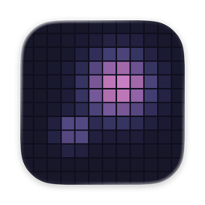
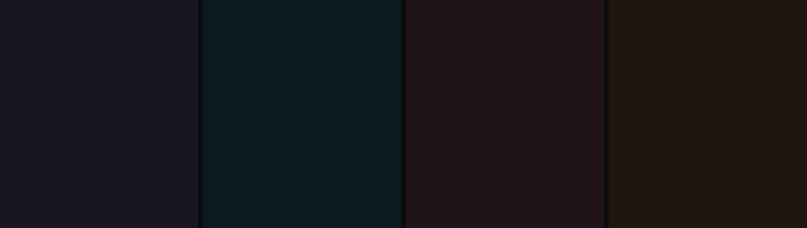
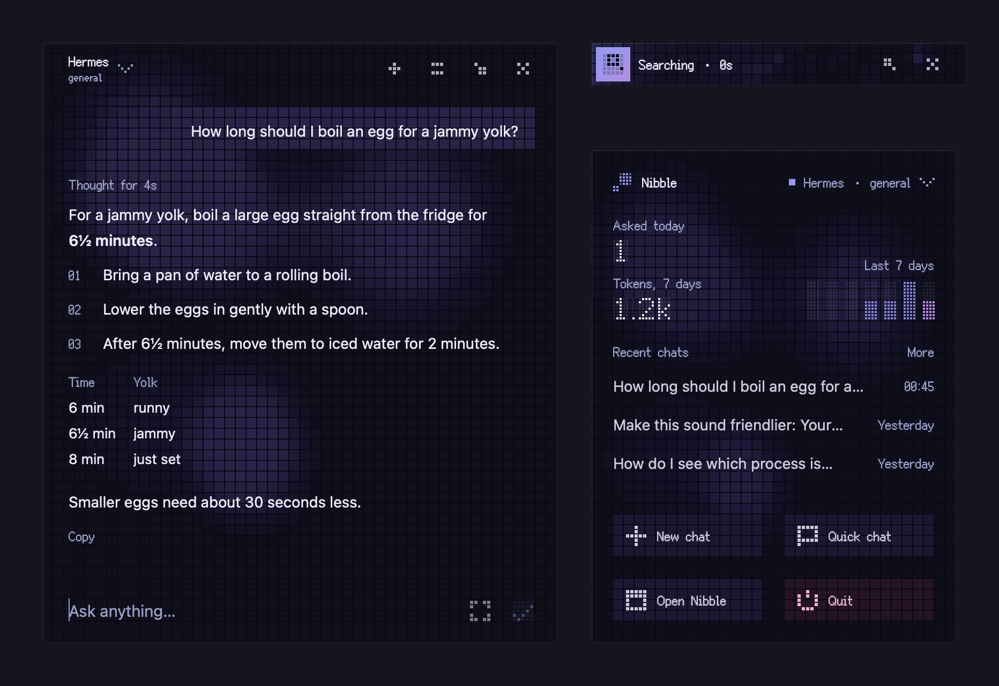
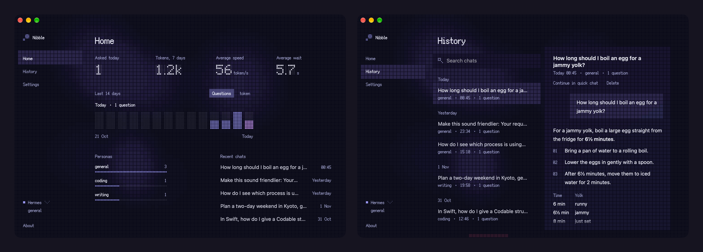

# Nibble

[简体中文](README.zh-CN.md)

Nibble is a quick chat panel for the Mac. A shortcut opens it over whatever you are doing, full-screen apps included, and the answer arrives in the same small window. Behind the text sits a board of square lights, and its motion shows what the reply is doing: waiting, thinking, searching the web, reading a page, running a command, writing, finished or failed.

Answers come from [Hermes Agent](https://github.com/NousResearch/hermes-agent) with its tools and memory, or straight from a model API: any OpenAI-compatible endpoint, Google Gemini or Anthropic Claude.

<p align="center">
  
</p>

## Features

- **Over everything.** ⌥Space (or a shortcut of your own) opens the panel on top of every app and every Space. The app you were in stays active, and an empty panel closes when you click elsewhere.
- **A light for every state.** The board answers each key you type. While a reply is on its way, lights run round the edges; thinking starts as a field of stars that turns into a tunnel the longer it goes on. A search sweeps across the board, a page being read fills with lines of light, a command types itself out like a terminal. A finished answer sends a ripple across the board, and a failure slows it almost to a stop and turns it red.
- **Folds into a strip.** While a long reply runs, the chat folds into a strip at its top right corner. The strip keeps showing what the reply is doing, and when a command needs your OK, Allow and Deny appear right on it.
- **Hermes Agent.** Each Hermes profile is a persona of its own, with its personality, model and memory. Commands Hermes asks to run can be allowed once, allowed for the rest of the conversation, or denied, from the panel. Deleting a conversation in Nibble also deletes its Hermes session.
- **Model APIs.** OpenAI-compatible endpoints (DeepSeek, Ollama, OpenRouter and others), Gemini and Claude, with personas you write yourself: a name and the instructions it answers with. With these services the latest question can be edited and asked again, and the new answer takes the old one's place.
- **Images.** Paste or drop an image into the panel, or capture the screen with one key.
- **Readable answers.** Markdown with lists, tables and code, how long the model thought and how fast it wrote.
- **A main window and a menu bar panel.** Home charts questions and tokens over the last two weeks, with how fast answers came; history keeps every conversation, searchable, to read or continue; settings cover the rest.
- **Your look.** Six colour themes, light and dark, three text sizes, an idle light of your choice, Chinese and English.

<p align="center">
  
</p>
<p align="center">
  
</p>

## Requirements

macOS 26 or later, on Apple silicon or Intel.

## Install

Download the latest version from [Releases](https://github.com/Glimmer-X/Nibble/releases), unzip it and move Nibble to Applications. Builds are signed and notarized by Apple.

To build it yourself you need Xcode 27 and [XcodeGen](https://github.com/yonaskolb/XcodeGen) (`brew install xcodegen`):

```bash
scripts/build.sh release
```

The script prints where the app is. Builds are signed ad hoc unless `local.env` names an Apple Developer team (see `local.env.example`); with a team, macOS keeps privacy permissions such as Screen Recording across rebuilds.

## Connecting a service

Open Settings with ⌘, (or from the main window's sidebar) and pick a service under Connection.

### Hermes Agent

Nibble talks to the API server built into Hermes's gateway.

1. Give the profile an API key: add a line such as `API_SERVER_KEY=` followed by a random string of 16 or more characters to its `.env` (`~/.hermes/.env` for the default profile, `~/.hermes/profiles/<name>/.env` for the others).
2. Start the gateway with `hermes gateway`, or keep it running from login with `hermes gateway install --start-now --start-on-login`.
3. In Nibble, choose Hermes. The address is `http://127.0.0.1:8642` unless the gateway runs elsewhere. With Hermes on the same Mac, Nibble reads each profile's key from its `.env`; for a Hermes elsewhere, paste the key.

The personas you can pick are the Hermes profiles.

### A model API

Choose OpenAI-compatible, Gemini or Claude, paste an API key and pick a model. An OpenAI-compatible service also needs its address, for example `https://api.deepseek.com` or `http://localhost:11434` for Ollama. Personas for these services are written in Settings.

## Privacy

Nibble sends your messages only to the service you set up, and collects nothing else. Conversations and settings are files in `~/Library/Application Support/com.glimmer.Nibble`; history is kept for 7, 30 or 90 days, as you choose. API keys are kept in the Keychain. With Hermes on the same Mac, Nibble reads the profile's key from Hermes's `.env` and never writes there. The screen is captured only when you press the capture key, which asks for Screen Recording permission the first time.

## Uninstall

Quit Nibble, move it to the Trash, and delete `~/Library/Application Support/com.glimmer.Nibble` and `~/Library/Preferences/com.glimmer.Nibble.plist`. Keys you pasted are in Keychain Access under `com.glimmer.Nibble`.

## Development

[docs/ARCHITECTURE.md](docs/ARCHITECTURE.md) describes how the code is organised, and [docs/research](docs/research) holds notes on the Hermes API and on macOS. `scripts/test.sh` runs the tests without opening any window. `scripts/run.sh` builds and opens the development build, "Nibble Dev", which keeps its data apart from an installed Nibble; `-NibbleScript sample` makes it answer from a script instead of a real service.

## License

Nibble is released under the [MIT License](LICENSE). Its pixel typeface is [Fusion Pixel Font](https://github.com/TakWolf/fusion-pixel-font), under the SIL Open Font License; see [THIRD-PARTY-NOTICES.md](THIRD-PARTY-NOTICES.md).
