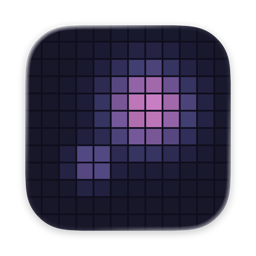
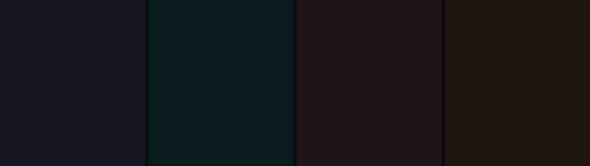
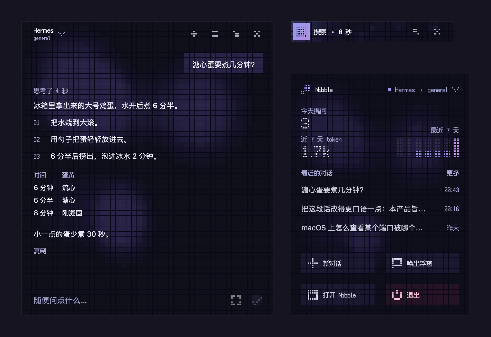
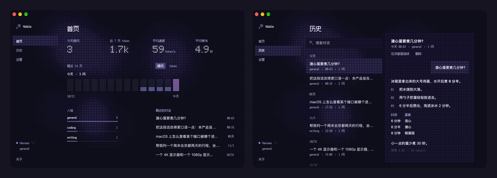

# Nibble

[English](README.md)

Nibble 是 Mac 上的快捷聊天浮窗。按下快捷键，浮窗出现在所有窗口之上，全屏应用里也一样，提问和回答都在这个小窗口里完成。文字背后是一块由方格灯组成的灯板，灯光随回答的进度变化，等待、思考、搜索、阅读网页、运行命令、输出、完成和出错各有各的样子。

回答可以来自 [Hermes Agent](https://github.com/NousResearch/hermes-agent)，带着它的工具和记忆；也可以直接来自模型 API，支持兼容 OpenAI 的接口、Google Gemini 和 Anthropic Claude。

<p align="center">
  
</p>

## 功能

- **随时呼出。** ⌥Space（也可以换成别的快捷键）在任何应用、任何桌面上打开浮窗。原来的应用保持在前台，空着的浮窗在点别处时自动收起。
- **每个状态一种灯光。** 打字时，灯板跟着每个按键亮起。等待回复时，灯光沿着边缘转圈；思考从一片星空开始，想得越久越像穿过时光隧道。搜索时灯光横扫灯板，读网页时一行行亮起，运行命令时像终端一样逐行打出。回答完成时，一圈水波在灯板上荡开；出错时灯板慢到几乎停住，并变成红色。
- **收成状态条。** 回复较长时，聊天可以收进右上角的一条状态条，不再挡住下面的内容。状态条继续显示回复进行到哪一步，需要确认运行命令时，允许和拒绝直接出现在条上。
- **Hermes Agent。** 每个 Hermes 人格（profile）有自己的性格、模型和记忆，在 Nibble 里直接选用。Hermes 要运行命令时，可以在浮窗里允许一次、本对话都允许或拒绝。在 Nibble 里删除对话，Hermes 里对应的会话也一并删除。
- **模型 API。** 支持兼容 OpenAI 的接口（DeepSeek、Ollama、OpenRouter 等）、Gemini 和 Claude。人格由自己编写，包括名字和回答时遵循的指令。
- **图片。** 图片可以粘贴或拖进浮窗，也可以按截屏键截取屏幕。
- **好读的回答。** 支持 Markdown 的列表、表格和代码，并标出模型思考了多久、输出有多快。
- **主窗口和菜单栏面板。** 首页统计最近两周的提问和 token，以及回答的速度；历史保存全部对话，可以搜索、阅读，也可以回到浮窗接着聊；其余选项都在设置里。
- **外观。** 六种主题色，浅色和深色，三档字号，可选的待机灯光，中文和英文界面。

<p align="center">
  
</p>
<p align="center">
  
</p>

## 系统要求

macOS 26 或更高版本，Apple 芯片和 Intel 芯片的 Mac 都可以运行。

## 安装

从 [Releases](https://github.com/Glimmer-X/Nibble/releases) 下载最新版本，解压后把 Nibble 拖进「应用程序」。发布的版本经过签名和 Apple 公证。

自己编译需要 Xcode 27 和 [XcodeGen](https://github.com/yonaskolb/XcodeGen)（`brew install xcodegen`）。

```bash
scripts/build.sh release
```

脚本最后一行是 App 的位置。默认使用临时签名（ad hoc）。在 `local.env` 里填上 Apple 开发者团队（参考 `local.env.example`）后，改用这个团队签名，重新编译也不会丢掉屏幕录制等权限。

## 连接服务

按 ⌘, 或从主窗口侧边栏打开设置，在「连接」里选择服务。

### Hermes Agent

Nibble 通过 Hermes gateway 内置的 API 服务器和它通信。

1. 给人格设置 API 密钥。在它的 `.env` 里加一行 `API_SERVER_KEY=`，后面接一段 16 位以上的随机字符串。默认人格的文件是 `~/.hermes/.env`，其他人格在 `~/.hermes/profiles/<名字>/.env`。
2. 运行 `hermes gateway` 启动 gateway。要让它登录后自动运行，用 `hermes gateway install --start-now --start-on-login`。
3. 在 Nibble 里选择 Hermes。地址默认是 `http://127.0.0.1:8642`。Hermes 装在同一台 Mac 上时，Nibble 直接读取各人格 `.env` 里的密钥；装在别处时，把密钥粘贴进来。

可选的人格就是 Hermes 的各个 profile。

### 模型 API

选择兼容 OpenAI 的接口、Gemini 或 Claude，粘贴 API 密钥，再选模型。兼容 OpenAI 的服务还要填地址，比如 `https://api.deepseek.com`，或者 Ollama 的 `http://localhost:11434`。这些服务的人格在设置里编写。

## 隐私

Nibble 只把消息发给你设置的服务，不收集其他任何信息。对话和设置以文件形式保存在 `~/Library/Application Support/com.glimmer.Nibble`，历史可以选择保留 7、30 或 90 天。API 密钥存放在钥匙串里。Hermes 在同一台 Mac 上时，Nibble 只读取人格 `.env` 里的密钥，从不写入。只有按下截屏键时才会截取屏幕，第一次会请求屏幕录制权限。

## 卸载

退出 Nibble，把它移到废纸篓，再删除 `~/Library/Application Support/com.glimmer.Nibble` 和 `~/Library/Preferences/com.glimmer.Nibble.plist`。粘贴过的密钥可以在「钥匙串访问」里按 `com.glimmer.Nibble` 找到。

## 开发

[docs/ARCHITECTURE.md](docs/ARCHITECTURE.md)（英文）说明代码的组织方式，[docs/research](docs/research) 里是关于 Hermes API 和 macOS 的笔记。`scripts/test.sh` 运行测试，不会打开任何窗口。`scripts/run.sh` 编译并打开开发版「Nibble Dev」，它的数据和正式安装的 Nibble 分开；加上 `-NibbleScript sample` 后，回答来自脚本，不连接真实服务。

## 许可

Nibble 以 [MIT 许可证](LICENSE)发布。界面使用的像素字体是 [Fusion Pixel Font](https://github.com/TakWolf/fusion-pixel-font)，采用 SIL 开放字体许可证，详见 [THIRD-PARTY-NOTICES.md](THIRD-PARTY-NOTICES.md)。
